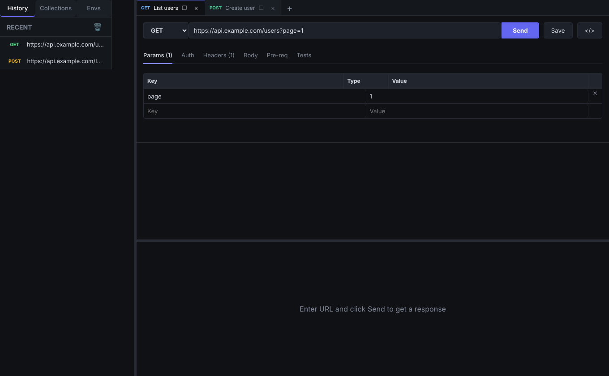
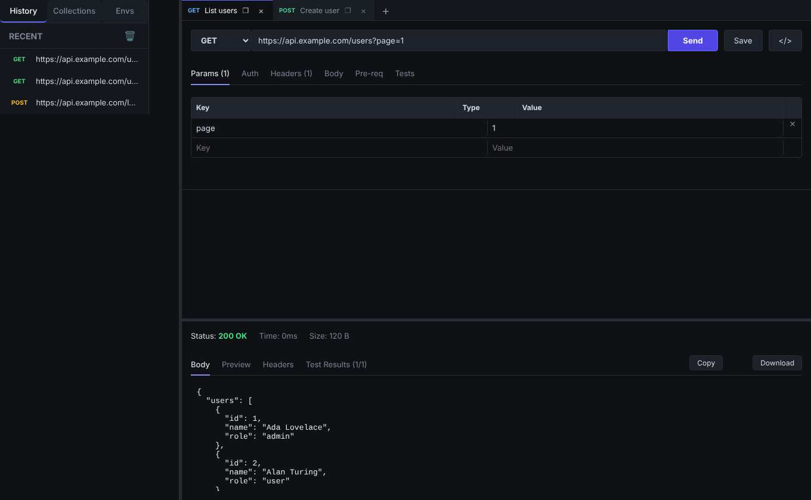
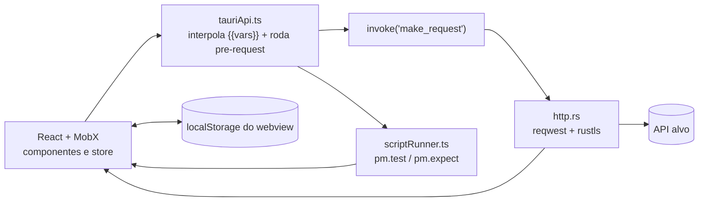

# PingHermano

Cliente de API desktop no estilo Postman: abas de requisição, coleções, ambientes com `{{variáveis}}`, scripts de pre-request/testes, histórico e visualização de resposta — construído com **Tauri 2** (Rust), **React** e **MobX**.

| Editor de requisição | Resposta com body, headers e testes |
|---|---|
|  |  |

## Recursos

- **Abas persistentes** — cada aba guarda método, URL, headers, body e auth; o conjunto é restaurado ao abrir o app.
- **Histórico** — as 50 requisições mais recentes, sem duplicar método + URL iguais.
- **Coleções** — agrupe requisições nomeadas, com auth e scripts preservados; renomeie e exclua pela sidebar.
- **Ambientes** — variáveis com `{{nome}}` interpoladas em URL, headers, body, query e form-data; um ambiente ativo por vez.
- **Métodos e corpo** — `GET`, `POST`, `PUT`, `DELETE`, `PATCH`, `HEAD`, `OPTIONS`; body texto/JSON, `form-data` (com arquivos) e `x-www-form-urlencoded`.
- **Autenticação** — Bearer, Basic e API Key (no header ou na query).
- **Scripts** — pre-request e testes com um subconjunto da API `pm`: `pm.environment`, `pm.response`, `pm.test`, `pm.expect` e `console`.
- **Resposta** — abas Body, Preview, Tree, Headers, Test Results e Timeline (TTFB + download); copiar e baixar.
- **Gerador de código** — cURL e `fetch` a partir da requisição atual.
- **Cancelamento** — aborta uma requisição em andamento sem fechar o app.
- **Paleta de comandos** — `Ctrl/Cmd+K` para nova aba, enviar, cancelar, trocar tema, ativar ambiente ou abrir requisição salva.

## Instalação

O projeto é distribuído como código-fonte; não há instalador publicado nas releases. Para rodar:

Pré-requisitos:

- Node.js 20+ e **pnpm 10.34.5** (declarado em `packageManager`)
- Rust estável
- [pré-requisitos do Tauri 2](https://tauri.app/start/prerequisites/) para a sua plataforma (webview, toolchain C++ etc.)

```bash
git clone https://github.com/juninmd/post-hermano.git
cd post-hermano
pnpm install
pnpm tauri:dev        # app desktop com hot reload
```

Para gerar o instalador da sua plataforma:

```bash
pnpm tauri:build
```

Os artefatos ficam em `src-tauri/target/release/bundle/`. Para trabalhar só na UI, `pnpm dev` sobe o Vite no navegador — mas sem o backend Rust as requisições não são executadas.

## Uso

1. **Escolha o método e a URL.** Se você omitir o esquema, o backend assume `http://`.
2. **Preencha Params, Headers, Body ou Auth.** As abas do editor ficam abaixo da URL; headers vazios são ignorados.
3. **Envie** com o botão **Send** ou `Ctrl/Cmd+Enter`. Durante a requisição, **Cancel** aborta via `cancel_request`.
4. **Leia a resposta.** Body (texto formatado), Preview (HTML em iframe), Tree (JSON navegável), Headers, Test Results e Timeline.
5. **Salve em uma coleção** pelo botão **Save**; o app pede o nome e, se houver mais de uma coleção, o índice dela.
6. **Reaproveite** pelo histórico, pela sidebar de coleções ou pela paleta `Ctrl/Cmd+K`.

### Ambientes e variáveis

Crie um ambiente na aba **Environments** com pares como `baseUrl` e `token`, ative-o e use `{{baseUrl}}/users` na URL. A substituição acontece no renderer antes do `invoke`, então vale também para headers e body. Variáveis não encontradas permanecem como `{{nome}}` e seguem para o servidor.

### Scripts

No editor, as abas **Pre-request** e **Tests** aceitam JavaScript. Exemplo de teste:

```js
pm.test('status 200', () => {
  pm.expect(pm.response.code).to.equal(200);
});

pm.test('tem id', () => {
  pm.expect(pm.response.json()).to.have.property('id');
});
```

Um pre-request pode definir uma variável para a requisição atual:

```js
pm.environment.set('ts', Date.now());
```

`pm.expect` cobre `equal`, `eql`, `include`, `have.property`, `have.length`, `be.ok/true/false/above/below`. `console.log/info/warn/error` são capturados no resultado do script, mas a UI atual exibe apenas os testes — os logs não aparecem na resposta. O script roda em `new Function` no contexto da webview — **não** é um sandbox isolado (veja [Segurança](#segurança-e-privacidade)).

## Import e export

Na sidebar, as abas **Collections** e **Environments** têm botões de importar e exportar:

- **Exportar coleções** baixa `collections_<timestamp>.json`; **exportar ambientes** baixa `environments_<timestamp>.json`.
- **Importar** aceita um arquivo `.json` cujo conteúdo seja um **array** de coleções (com `requests`) ou de ambientes (com `variables`). Os IDs são regenerados para evitar colisão.
- O formato é o do próprio app. **Não** é o formato de coleção do Postman/Insomnia; um arquivo exportado do Postman não é importado diretamente.

Como o export inclui headers, auth e valores de ambiente, trate o arquivo como segredo.

## Como funciona



- **Store MobX** (`src/renderer/stores/RequestStore.ts`): abas, histórico, coleções, ambientes e o ciclo de envio. Um `autorun` com debounce salva as abas; `beforeunload` força o save final.
- **Ponte** (`src/renderer/api/tauriApi.ts`): interpola variáveis, converte form-data (lendo os `File` selecionados), chama o comando Rust e transforma a resposta — JSON é parseado quando o `content-type` contém `json`.
- **Backend** (`src-tauri/src/http.rs`): um `reqwest::Client` compartilhado (pool, gzip/brotli/deflate, TLS rustls), timeout de conexão de 30 s e total de 120 s. Cada requisição tem um `request_id` e um canal `oneshot` para cancelamento.
- **Scripts** (`src/renderer/api/scriptRunner.ts`): executa pre-request e testes, coleta resultados e logs e devolve o ambiente usado na interpolação.

Estrutura:

```text
src/renderer/
├── App.tsx                 # layout, atalhos, resize e tema
├── components/             # Sidebar, RequestEditor, ResponseViewer, TabList, modais
├── stores/RequestStore.ts  # estado MobX + persistência
├── api/                    # tauriApi.ts (invoke) e scriptRunner.ts (pm)
└── utils/codeGenerator.ts  # cURL e fetch
src-tauri/
├── src/http.rs             # execução HTTP e cancelamento
├── src/lib.rs              # registro do comando no Tauri
└── capabilities/default.json
```

## Segurança e privacidade

- **Nada passa por um servidor do projeto.** As requisições vão do seu computador direto para a URL configurada; não há código de telemetria ou analytics no repositório.
- **Credenciais ficam locais, mas sem cofre.** Tabs, histórico, coleções e ambientes são gravados no `localStorage` do webview, nos dados locais do app (identificador `com.pinghermano.app`) — incluindo headers `Authorization`, tokens de ambiente e corpos de requisição. Não há Keychain/Credential Manager nem criptografia em repouso. Quem tiver acesso ao perfil do usuário consegue ler esses dados.
- **Export é sensível.** Os JSONs de coleções e ambientes carregam auth e variáveis; não os anexe em issues ou PRs.
- **Scripts são código.** Pre-request e testes rodam com `new Function` dentro da webview, com acesso ao `window` e ao `localStorage` do app; a CSP libera `unsafe-eval` para isso. Não execute scripts de coleções que você não confia.
- **Preview isolado.** O HTML da resposta é renderizado em um `<iframe sandbox="allow-scripts">` com `srcDoc`, sem `allow-same-origin`.
- **Privilégios mínimos no Tauri.** A capability padrão só concede `core:default`; não há plugins de shell, filesystem ou updater. A rede sai apenas pelo comando `make_request`.
- **TLS via rustls** no cliente Rust, sem depender do TLS do sistema.

## Desenvolvimento e testes

```bash
pnpm install
pnpm dev              # UI no navegador (sem backend nativo)
pnpm build            # build do frontend (Vite)
pnpm tauri:dev        # app desktop com hot reload
pnpm tauri:build      # instalador da plataforma
pnpm test             # Vitest (jsdom + Testing Library)
pnpm typecheck        # tsc --noEmit
```

Os testes cobrem store, editor, resposta, sidebar, paleta, gerador de código e o runner de scripts (`src/**/*.test.ts(x)`). O runner usa `vitest` com ambiente `jsdom` e setup de Testing Library.

| Workflow | O que faz |
|---|---|
| `validate.yml` | Gate de validação de PR/push via workflow reutilizável |
| `sast.yml` | Análise estática (Semgrep), em modo relatório |
| `security.yml` | Varredura de segredos com Gitleaks |
| `release-drafter.yml` | Mantém o rascunho de release a partir de PRs |
| `dependabot-auto-merge.yml` | Auto-merge de PRs do Dependabot com checks verdes |

Não há workflow que compile ou publique instaladores; o `tauri:build` é local.

## Limitações

- **Corpo de resposta é texto.** O backend usa `res.text()`, então respostas binárias (imagens, PDFs, zips) não são preservadas; o botão **Download** grava o texto formatado como `response.json`.
- **Sem gerenciamento de cookies.** O cliente `reqwest` não habilita cookie store; fluxos que dependem de cookie de sessão precisam de header explícito.
- **Histórico limitado a 50 entradas**, sem duplicatas de método + URL.
- **Import/export é proprietário.** Não há conversão de/para Postman v2.1, Insomnia ou OpenAPI.
- **API `pm` parcial.** Não existem `pm.sendRequest`, `pm.request`, variáveis de coleção ou globais; `pm.environment.set` vale para a requisição/testes atuais e não é persistido no ambiente salvo.
- **Arquivos de form-data vivem em memória.** Depois de reiniciar o app, é preciso selecionar o arquivo novamente; o backend responde com “select it again” se o byte array não estiver disponível.
- **Sem WebSocket, SSE ou GraphQL dedicado.** É um cliente HTTP requisição/resposta.
- **Salvar em coleção usa `prompt`.** O nome e o índice da coleção são pedidos em caixas de diálogo do navegador, não em um formulário.
- **Sem binários publicados.** As releases existentes não têm assets; hoje é necessário compilar.

## Licença

O `package.json` declara **ISC**, mas o repositório não inclui arquivo `LICENSE`. Confirme os termos com o mantenedor antes de redistribuir.
